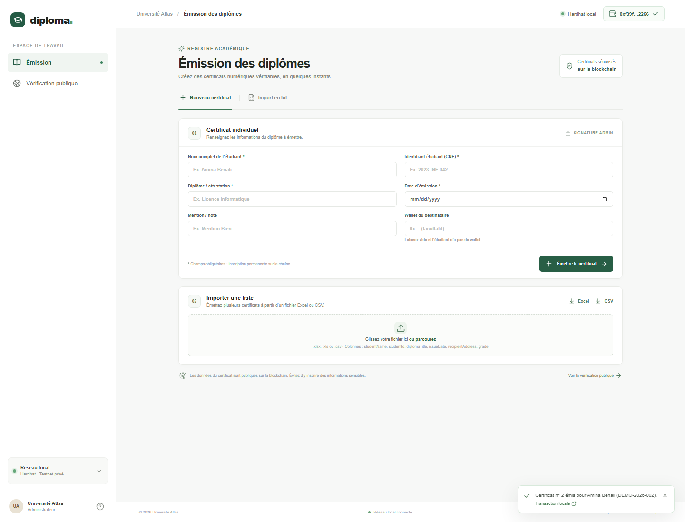

# Diploma — certificats académiques vérifiables

Petit projet pédagogique : un contrat Solidity conserve les certificats, un site React permet de les émettre, et une page publique permet de les vérifier.

## Ce qu’il faut installer

- **Node.js LTS** (npm est inclus) : https://nodejs.org/
- **MetaMask** dans le navigateur : https://metamask.io/

Aucune clé API n’est requise pour la démonstration locale. Les frais de transaction sont payés en ETH de test fourni par Hardhat. N’utilisez jamais une vraie clé privée dans ce projet.

## Démarrage local — Windows PowerShell

Ouvrez trois terminaux PowerShell dans le dossier du projet.

### 1. Installer les dépendances (une seule fois)

Dans le premier terminal :

```powershell
npm.cmd install
npm.cmd --prefix frontend install
```

### 2. Démarrer la blockchain locale

Dans le premier terminal :

```powershell
npm.cmd run chain
```

Gardez ce terminal ouvert. Hardhat fournit une blockchain locale et des comptes de démonstration préfinancés.

### 3. Déployer le contrat

Dans le deuxième terminal :

```powershell
npm.cmd run deploy:local
```

Le terminal affiche l’adresse du contrat. Le script inscrit automatiquement cette adresse et l’ABI dans `frontend/src/contract.json` pour que le site puisse le joindre.

Adresse du contrat actuellement déployé sur Hardhat Local : `0xCf7Ed3AccA5a467e9e704C703E8D87F634fB0Fc9`. Une adresse locale est valable tant que la blockchain Hardhat n’est pas réinitialisée. Après un nouveau déploiement, relevez la nouvelle adresse affichée dans le terminal.

### 4. Ouvrir le site

Dans le troisième terminal :

```powershell
npm.cmd run frontend
```

Ouvrez l’adresse locale affichée par Vite, en général http://localhost:5173.

### 5. Connecter MetaMask au réseau local

Dans MetaMask, ajoutez un réseau avec ces paramètres :

| Paramètre | Valeur |
|---|---|
| Nom | Hardhat Local |
| URL RPC | `http://127.0.0.1:8545` |
| Identifiant de chaîne | `31337` |
| Symbole | `ETH` |

Pour une démonstration locale, importez dans MetaMask un compte de test affiché par le terminal `npm.cmd run chain`. Le **premier compte** appartient au déployeur : seul ce compte peut émettre ou révoquer. Les comptes de test et leurs clés sont publics et jetables. Ne les utilisez jamais ailleurs.

## Utiliser l’application

1. Dans **Émission des diplômes**, connectez MetaMask avec le compte déployeur.
2. Remplissez le formulaire puis cliquez **Émettre le certificat**. MetaMask demande de confirmer la transaction.
3. Pour un import, utilisez **Fichier exemple**, ou préparez un fichier Excel/CSV avec les en-têtes exacts ci-dessous. Les lignes avec erreurs sont désactivées ; corrigez-les puis réimportez le fichier.
4. Cochez les lignes valides et cliquez **Émettre la sélection**. Le site découpe automatiquement la sélection en transactions de dix certificats maximum.
5. Dans **Vérification publique**, cherchez un certificat par son identifiant numérique. Le premier certificat créé porte l’identifiant `1`.

## Capture d’écran d’un mint réussi

Cette capture montre l’émission réussie du certificat de démonstration `DEMO-2026-002` (Amina Benali), numéro `2`, sur Hardhat Local :



Les fichiers [frontend/public/etudiants-exemple.xlsx](frontend/public/etudiants-exemple.xlsx) et [frontend/public/etudiants-exemple.csv](frontend/public/etudiants-exemple.csv) utilisent les trois premiers comptes de test Hardhat comme destinataires ; ils sont déjà configurés dans ce réseau local. Les dates doivent respecter le format ISO `AAAA-MM-JJ`. Le grade et l’adresse wallet sont facultatifs. Si l’adresse est vide, le contrat enregistre `0x0000000000000000000000000000000000000000`, ce qui signifie « pas de wallet fourni ». Les en-têtes attendus sont :

```text
studentName,studentId,diplomaTitle,issueDate,recipientAddress,grade
```

## Le contrat, en bref

Tout le backend pédagogique se trouve dans `contracts/CertificateRegistry.sol` :

- `owner` est le compte qui déploie le contrat.
- `mintCertificate` vérifie les champs indispensables et refuse un `studentId` déjà utilisé.
- `batchMint` vérifie que les six listes ont la même taille, puis appelle la même logique d’émission pour chaque ligne.
- `getCertificate` lit les données sans modifier la blockchain (`view`).
- `revoke` marque un certificat comme révoqué ; il ne supprime pas son historique.
- `CertificateMinted` et `CertificateRevoked` sont les événements publics du contrat.

L’identifiant de certificat commence à `1` et augmente à chaque émission. Les données sont publiques et persistantes : ne stockez pas d’informations personnelles sensibles sur une blockchain publique. Ici, le CNE est utilisé uniquement pour illustrer le devoir.

## Structure du projet

```text
contracts/                 Contrat Solidity
scripts/deploy.js          Déploiement et configuration du frontend
test/                      Tests de contrat (Hardhat)
frontend/src/              Application React et styles
frontend/public/           Fichiers Excel et CSV de démonstration
```

## Réseau Sepolia (facultatif)

Le projet est configuré d’abord pour Hardhat local. Sepolia demande un endpoint RPC fourni par un service de votre choix et un peu d’ETH de test Sepolia. N’ajoutez pas de clé privée au code frontend ni au dépôt. Le déploiement Sepolia n’est pas activé dans la configuration livrée afin d’éviter qu’une phrase secrète ou une clé soit enregistrée dans le projet par erreur.
